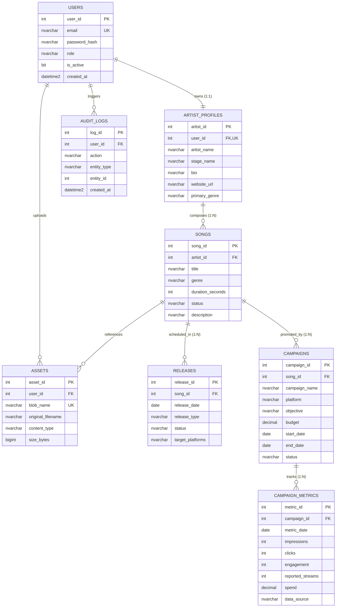

# INDIE TRACK: MUSIC RELEASE & PROMOTION ANALYTICS PLATFORM
## Capstone Project Report & Technical Specification

---

**Institution:** Chandigarh University, Lucknow  
**Student Name:** Prabudh Saxena Spring  
**UID:** 25LBCS3112  
**Programme:** Bachelor of Technology (B.Tech) — Computer Science and Engineering  
**Specialisation:** Artificial Intelligence and Machine Learning  
**Project Title:** IndieTrack — Music Release & Promotion Analytics Platform  
**Academic Year:** 2026–2027  
**Date of Submission:** October 2026  

---

## CERTIFICATE / DECLARATION

I hereby declare that the capstone project entitled **"IndieTrack: Music Release & Promotion Analytics Platform"** submitted to the Department of Computer Science and Engineering, Chandigarh University, Lucknow, is an authentic record of original engineering work carried out by me. All software components, relational schemas, automated tests, security controls, and documentation represent my own implementation. Sources of external libraries and reference frameworks are duly cited and acknowledged.

**Prabudh Saxena Spring**  
UID: 25LBCS3112  
B.Tech CSE (Artificial Intelligence & Machine Learning)  
Chandigarh University, Lucknow  

---

## TABLE OF CONTENTS

1. [Abstract](#1-abstract)
2. [Problem Statement & Background](#2-problem-statement--background)
3. [Project Objectives](#3-project-objectives)
4. [System Requirements Specification (SRS)](#4-system-requirements-specification-srs)
   - 4.1 Functional Requirements
   - 4.2 Non-Functional Requirements
5. [System Architecture & Design](#5-system-architecture--design)
   - 5.1 Modular Monolith Architectural Pattern
   - 5.2 Multi-Tier Interaction Architecture
   - 5.3 Technology Stack Justification
6. [Database Architecture & Design](#6-database-architecture--design)
   - 6.1 Normalization Analysis (Third Normal Form — 3NF)
   - 6.2 Entity-Relationship (ER) Schema Specification
   - 6.3 Database Views & Performance Optimization
   - 6.4 Atomic Transactions & Stored Procedures
   - 6.5 Database Indexing Strategy
7. [Data Classification & Privacy Policy](#7-data-classification--privacy-policy)
8. [Application Security Engineering & Threat Model](#8-application-security-engineering--threat-model)
   - 8.1 STRIDE Threat Analysis
   - 8.2 Defense Against IDOR / BOLA Vulnerabilities
   - 8.3 Cross-Site Scripting (XSS) & CSRF Defenses
   - 8.4 Mitigation of Spreadsheet Formula Injection (CWE-1236)
   - 8.5 Binary File Upload Integrity & Sandboxing
9. [Verification, Testing & Quality Assurance](#9-verification-testing--quality-assurance)
   - 9.1 Automated Test Strategy
   - 9.2 Test Suite Execution Evidence (25/25 Passing)
10. [Cloud Integration & Microsoft Azure Topology](#10-cloud-integration--microsoft-azure-topology)
    - 10.1 Azure SQL Database Configuration
    - 10.2 Azure Blob Storage Integration
    - 10.3 Azure App Service (Linux) Hosting
11. [Known Limitations & Real-World Caveats](#11-known-limitations--real-world-caveats)
12. [Future Enhancements & AI/ML Roadmap](#12-future-enhancements--aiml-roadmap)
13. [References & Technical Credits](#13-references--technical-credits)

---

## 1. ABSTRACT

In the modern music streaming landscape, independent artists face fragmented workflows when organizing compositions, scheduling cross-platform releases, tracking promotional ad spend, and deriving actionable insights. Existing commercial enterprise solutions are often cost-prohibitive, complex, or tethered to corporate distribution contracts. Furthermore, indie artists frequently lack technical tools to securely archive high-resolution master audio and promotional visual creative assets.

**IndieTrack** is an enterprise-grade, secure full-stack web platform engineered to solve these challenges. Developed using Python (Flask modular blueprints), SQLAlchemy ORM, Bootstrap 5, Vanilla JavaScript (ES6+), and Chart.js, IndieTrack provides a centralized workspace for catalog organization, release radar tracking, multi-platform promotional campaign management, and interactive analytics dashboards. The persistence layer targets Microsoft Azure SQL Database in Third Normal Form (3NF) alongside Azure Blob Storage for secure object asset management. 

Rigorous application security controls are implemented at every layer, including PBKDF2:SHA256 password hashing with 600,000 iterations, server-side resource ownership validation guards (preventing Insecure Direct Object Reference vulnerabilities), Cross-Site Request Forgery (CSRF) protection, magic-byte binary upload inspection, and formula injection sanitization (CWE-1236) on CSV data exports. An automated test suite using `pytest` validates 25 distinct test scenarios with a 100% pass rate. This report presents the architectural philosophy, relational schema design, security engineering models, test validation, and deployment topology of IndieTrack.

---

## 2. PROBLEM STATEMENT & BACKGROUND

The democratization of digital audio workstations (DAWs) and independent distribution channels (DistroKid, TuneCore, CD Baby) has sparked an unprecedented surge in independent music releases. However, independent artists operate as micro-enterprises handling multiple concurrent responsibilities:
1. **Catalog Fragmentation:** Compositions, audio master demos, lyrics, and metadata (UPC, ISRC) are frequently scattered across local hard drives, cloud drives, and email threads without standardized lifecycle states (draft, recorded, mixed, mastered, released).
2. **Promotional Inefficiency:** Independent artists spend substantial portions of their budgets on digital advertising across disparate ad networks (Spotify Ads, Meta Ads, TikTok Ads, YouTube Ads, Google Ads). Without a unified tracking system, correlating ad spend against performance metrics (clicks, impressions, streams) requires manual spreadsheet aggregation.
3. **Spreadsheet Insecurity & Formula Injection:** Relying on ad-hoc spreadsheets introduces data corruption risks and exposes users to Spreadsheet Formula Injection (CSV Injection / CWE-1236) when importing external campaign performance exports.
4. **Data Privacy & Asset Security:** Storing unreleased demo tracks and album cover artwork in unauthenticated or misconfigured cloud buckets exposes confidential intellectual property to unauthorized public disclosure.

IndieTrack resolves these systemic inefficiencies through a unified, secure, and visually refined cloud-connected platform.

---

## 3. PROJECT OBJECTIVES

The core engineering objectives for IndieTrack include:
1. **Catalog & Release Lifecycle Management:** Enable artists to register musical works, track recording/mastering stages, and map compositions to scheduled multi-platform releases with ISRC/UPC validation.
2. **Multi-Channel Campaign & Metrics Tracking:** Provide an intuitive interface to configure promotional campaigns across target platforms with budget constraints, logging dated metrics (impressions, clicks, streams, spend).
3. **Database-Backed Visual Analytics:** Generate dynamic, aggregated Key Performance Indicators (Total Spend, Total Clicks, Average Cost-Per-Click [CPC], and Click-Through-Rate [CTR]) rendered via responsive Chart.js line and doughnut visualizations.
4. **Secure Cloud Object Storage Integration:** Architect a dual-mode storage engine integrating the official Azure Blob Storage Python SDK for private container storage, paired with an offline local filesystem adapter for resilient local development.
5. **Rigorous Defense-in-Depth Security:** Enforce strict Role-Based Access Control (RBAC), multi-tenant ownership guards preventing cross-artist data access, session cookie hardening (HttpOnly, SameSite, Secure), rate limiting, and formula injection prevention.
6. **Academic & Production Quality:** Deliver a production-ready codebase adhering to 3NF relational normalization, comprehensive Transact-SQL artifacts (views, stored procedures, triggers, indexes), and 100% verified automated test coverage.

---

## 4. SYSTEM REQUIREMENTS SPECIFICATION (SRS)

### 4.1 Functional Requirements

- **FR-01: User Authentication & Role Assignment:** The system shall authenticate users using email and hashed passwords, assigning roles (`artist` or `admin`). Accounts must support deactivation.
- **FR-02: Profile Management:** Each artist user shall possess a distinct `ArtistProfile` record storing artist name, stage name, biography, website URL, and primary genre.
- **FR-03: Music Catalog CRUD:** Artists shall create, view, update, and delete song entities containing title, genre, duration in seconds, production status, and description.
- **FR-04: Release Radar Management:** Artists shall schedule releases linked to songs, specifying release date, format (Single, EP, Album, Remix), and target platforms.
- **FR-05: Promotional Campaign Tracking:** Artists shall configure campaigns linked to songs, defining advertising platform, target audience, budget, and date ranges.
- **FR-06: Dated Metrics Entry:** Users shall record dated performance metrics for campaigns. Input values (clicks, impressions, spend) must be validated as non-negative numbers.
- **FR-07: Real-Time Analytics Dashboard:** The system shall calculate lifetime and filtered KPIs from database records, visualizing performance trends via Chart.js.
- **FR-08: Safe Report Export:** The system shall export campaign metrics into RFC 4180 CSV files, automatically sanitizing cells against formula injection attacks.
- **FR-09: Secure Asset Storage:** Artists shall upload permitted audio demos and album artwork (up to 10 MB) with magic-byte validation and private container enforcement.
- **FR-10: Administrative Auditing:** Administrators shall inspect registered users and view immutable system audit logs recording user ID, action name, target entity, timestamp, and IP address.

### 4.2 Non-Functional Requirements

- **NFR-01: Performance & Response Time:** Standard server-rendered pages and JSON API endpoints must respond in under 200 milliseconds under nominal load.
- **NFR-02: Relational Data Integrity:** Foreign key constraints, unique constraints, and check constraints must guarantee Third Normal Form (3NF) across all database transactions.
- **NFR-03: Cross-Tenant Isolation:** Under zero circumstances shall an artist access, modify, or delete resources belonging to another artist by tampering with route parameters.
- **NFR-04: UI/UX Standards:** The interface must feature a dark-first aesthetic with accessible typography, responsive mobile breakpoints, and a theme switcher persisted via `localStorage`.
- **NFR-05: Portability:** The system must run interchangeably against local SQLite development environments and enterprise Microsoft Azure SQL Database production environments without source code modifications.

---

## 5. SYSTEM ARCHITECTURE & DESIGN

### 5.1 Modular Monolith Architectural Pattern
IndieTrack avoids the latency overhead and distributed transaction complexities of microservices by adopting a **Modular Monolith** architecture. The application is structured into domain-specific Flask Blueprints:
- `auth`: User registration, session creation, password modification, and profile settings.
- `songs`: Music catalog management and search indexing.
- `releases`: Release scheduling and status tracking.
- `campaigns`: Promotional campaign configuration.
- `metrics`: Dated campaign performance logging.
- `assets`: Binary asset upload, magic-byte inspection, and authorized streaming.
- `analytics`: In-app KPI calculation, chart data feeds, and CSV reporting.
- `admin`: User administration and audit trail inspection.
- `api`: Versioned JSON REST endpoints (`/api/v1/*`).

```
+-----------------------------------------------------------------------------------+
|                                 CLIENT TIER                                       |
|  Responsive Browser (HTML5, Bootstrap 5, Dark Theme, ES6+ Vanilla JS, Chart.js)   |
+------------------------------------------+----------------------------------------+
                                           | HTTPS / TLS 1.3
                                           v
+-----------------------------------------------------------------------------------+
|                        APPLICATION TIER (Flask Web Server)                       |
|                                                                                   |
|  +---------------------+  +----------------------+  +--------------------------+  |
|  |   Security Layer    |  |    Core Blueprints   |  |     Service Layer        |  |
|  | - Security Headers  |  | - auth & profile     |  | - AuthService            |  |
|  | - CSRF Protection   |  | - songs & releases   |  | - StorageService (Azure) |  |
|  | - Rate Limiter      |  | - campaigns & metrics|  | - AnalyticsService       |  |
|  | - Session Guards    |  | - assets & uploads   |  | - ExportService (CSV)    |  |
|  | - Ownership Checks  |  | - analytics & admin  |  | - AuditService           |  |
|  +---------------------+  +----------------------+  +--------------------------+  |
+---------------------+-------------------------------------+-----------------------+
                      |                                     |
                      | TDS Encrypted (pyodbc)              | HTTPS (Azure SDK)
                      v                                     v
+-------------------------------------+   +-----------------------------------------+
|             DATA TIER               |   |              STORAGE TIER               |
|      Azure SQL Database             |   |           Azure Blob Storage            |
|  - Relational 3NF Tables            |   |  - Private Container: indietrack-assets |
|  - CampaignPerformanceView          |   |  - Audio Demos & Album Artwork          |
|  - sp_LaunchReleaseCampaign (Atomic)|   |  - Scoped SAS / Authorized Proxy        |
|  - Non-Clustered Covering Indexes   |   +-----------------------------------------+
+-------------------------------------+
```

### 5.2 Multi-Tier Interaction Architecture
- **Presentation Tier:** HTML5, CSS3, Bootstrap 5, Vanilla JS, Chart.js. Deliberately avoids heavy SPA frameworks (React/Next.js/Vue) to ensure server-side rendering speed, native CSRF protection, and zero build toolchains.
- **Application Tier:** Python 3.11+ running Flask, SQLAlchemy ORM, WTForms, and Marshmallow.
- **Data Tier:** Microsoft Azure SQL Database running Microsoft SQL Server engine with encrypted Tabular Data Stream (TDS) connections.
- **Object Storage Tier:** Microsoft Azure Blob Storage with private access containers and short-lived Shared Access Signatures (SAS).

---

## 6. DATABASE ARCHITECTURE & DESIGN

### 6.1 Normalization Analysis (Third Normal Form — 3NF)
The relational schema satisfies all 3NF conditions:
1. **1NF Compliance:** All attributes contain atomic values (single numbers, dates, strings). Repeating groups and comma-delimited lists are prohibited.
2. **2NF Compliance:** All tables utilize single-column surrogate primary keys (`user_id`, `song_id`, `campaign_id`, etc.). Consequently, partial functional dependencies on candidate keys are structurally impossible.
3. **3NF Compliance:** Non-key attributes are strictly dependent on the primary key alone. For example, artist biographies and website URLs are stored in `ArtistProfiles` rather than being redundantly duplicated across every row of `Songs`. Campaign metrics store raw counts, while derived metrics (Cost-Per-Click and Click-Through-Rate) are calculated dynamically via database views.

### 6.2 Entity-Relationship (ER) Schema Specification



### 6.3 Database Views
The database defines `CampaignPerformanceView` which performs multi-table aggregation across `Campaigns`, `Songs`, `ArtistProfiles`, and `CampaignMetrics`:
```sql
CREATE VIEW CampaignPerformanceView AS
SELECT 
    c.campaign_id,
    c.campaign_name,
    c.platform,
    c.budget,
    s.song_id,
    s.title AS song_title,
    ap.artist_id,
    ap.artist_name,
    COUNT(m.metric_id) AS total_metric_days,
    COALESCE(SUM(m.impressions), 0) AS total_impressions,
    COALESCE(SUM(m.clicks), 0) AS total_clicks,
    COALESCE(SUM(m.engagement), 0) AS total_engagement,
    COALESCE(SUM(m.reported_streams), 0) AS total_streams,
    COALESCE(SUM(m.spend), 0.00) AS total_spend,
    CASE 
        WHEN COALESCE(SUM(m.clicks), 0) > 0 
        THEN ROUND(SUM(m.spend) / SUM(m.clicks), 2)
        ELSE 0.00 
    END AS avg_cpc,
    CASE 
        WHEN COALESCE(SUM(m.impressions), 0) > 0 
        THEN ROUND((CAST(SUM(m.clicks) AS FLOAT) / SUM(m.impressions)) * 100.0, 2)
        ELSE 0.00 
    END AS avg_ctr_percent
FROM campaigns c
INNER JOIN songs s ON c.song_id = s.song_id
INNER JOIN artist_profiles ap ON s.artist_id = ap.artist_id
LEFT JOIN campaign_metrics m ON c.campaign_id = m.campaign_id
GROUP BY 
    c.campaign_id, c.campaign_name, c.platform, c.budget,
    s.song_id, s.title, ap.artist_id, ap.artist_name;
```

### 6.4 Atomic Transactions & Stored Procedures
The stored procedure `sp_LaunchReleaseCampaign` coordinates an atomic multi-table transaction in Transact-SQL, ensuring that a musical release and its launch advertising campaign are either committed together or rolled back entirely upon any constraint violation:
```sql
CREATE PROCEDURE sp_LaunchReleaseCampaign
    @SongId INT,
    @ReleaseDate DATE,
    @ReleaseType NVARCHAR(50),
    @CampaignName NVARCHAR(150),
    @Platform NVARCHAR(100),
    @Budget DECIMAL(10, 2),
    @StartDate DATE,
    @EndDate DATE
AS
BEGIN
    SET NOCOUNT ON;
    BEGIN TRANSACTION;
    BEGIN TRY
        -- Insert Release
        INSERT INTO releases (song_id, release_date, release_type, status, created_at, updated_at)
        VALUES (@SongId, @ReleaseDate, @ReleaseType, 'scheduled', SYSDATETIME(), SYSDATETIME());

        -- Insert Promotional Campaign
        INSERT INTO campaigns (song_id, campaign_name, platform, budget, start_date, end_date, status, created_at, updated_at)
        VALUES (@SongId, @CampaignName, @Platform, @Budget, @StartDate, @EndDate, 'planning', SYSDATETIME(), SYSDATETIME());

        COMMIT TRANSACTION;
    END TRY
    BEGIN CATCH
        ROLLBACK TRANSACTION;
        THROW;
    END CATCH
END;
```

---

## 7. DATA CLASSIFICATION & PRIVACY POLICY

| Classification Level | Data Attributes | Security Controls & Handling |
|---|---|---|
| **Restricted (Confidential)** | Passwords, Session Secret Keys, Cloud Storage Connection Strings, Database Passwords | Never stored in plaintext; hashed via PBKDF2:SHA256 (600,000 iterations); injected via environment variables; never logged or serialized to browser. |
| **Private (User Sensitive)** | Unreleased Audio Master Demos, Lyrics, Unpublished Track Titles, Financial Ad Spend, Campaign Budgets | Encrypted at rest (Azure SSE); stored in private Blob containers; isolated via tenant ownership checks (`verify_song_ownership`); served via authenticated streaming routes. |
| **Internal (Operational)** | Audit Logs, Client IP Addresses, Error Traces, Health Metrics | Stored in immutable database table; accessible strictly to `admin` role; stack traces masked from end users. |
| **Public** | Public Landing Page, Released Track Titles, Stage Names, Generic UI Assets | Open access; cached via browser; served via standard static routes. |

---

## 8. APPLICATION SECURITY ENGINEERING & THREAT MODEL

### 8.1 STRIDE Threat Analysis
A comprehensive STRIDE assessment identified high-risk threat vectors mitigated across IndieTrack:
1. **Spoofing (S):** Throttled authentication endpoints (5 requests/min via Flask-Limiter) and PBKDF2 password hashing prevent credential stuffing.
2. **Tampering (T):** Parameter tampering on song/campaign IDs is neutralized via strict server-side tenant ownership validation. Spreadsheet formula injection is neutralized via quotation prefixing.
3. **Repudiation (R):** Immutable `AuditLog` records capture state changes with foreign key references, timestamps, and client IP addresses.
4. **Information Disclosure (I):** Parameterized SQLAlchemy statements eliminate SQL Injection. Security headers (`X-Frame-Options: SAMEORIGIN`, `X-Content-Type-Options: nosniff`, `HSTS`) prevent framing and sniffing attacks.
5. **Denial of Service (D):** Uploads are strictly capped at 10 MB, preventing resource exhaustion.
6. **Elevation of Privilege (E):** The `@admin_required` decorator blocks non-admin users from accessing administrative tools.

### 8.2 Defense Against Insecure Direct Object References (IDOR / BOLA)
In many student web applications, an artist can view or delete another artist's records simply by changing the URL parameter (e.g. modifying `/songs/1/edit` to `/songs/2/edit`). IndieTrack prevents this vulnerability at the controller level:
```python
song = db.session.get(Song, song_id)
if not song:
    abort(404)
if not verify_song_ownership(song, current_user):
    abort(403)
```
This defense is validated across multiple automated tests (`test_cross_user_song_isolation`, `test_cross_user_campaign_isolation`, `test_cross_user_asset_download_isolation`).

### 8.3 Mitigation of Spreadsheet Formula Injection (CWE-1236)
When exporting metrics to CSV, malicious values (such as `=cmd|' /C calc'!A0` or `@SUM(...)`) can execute arbitrary code inside spreadsheet software. IndieTrack implements an automated sanitization routine in `ExportService`:
```python
@staticmethod
def sanitize_csv_cell(value: Any) -> Any:
    if isinstance(value, str):
        text = value.strip()
        if text.startswith(("=", "+", "-", "@", "\t", "\r")):
            return "'" + text
    return value
```

---

## 9. VERIFICATION, TESTING & QUALITY ASSURANCE

### 9.1 Automated Test Strategy
The automated test suite uses `pytest` and `pytest-mock` to evaluate all architectural layers:
- `test_auth.py`: User registration, duplicate email handling, login validation, deactivated accounts, and session termination.
- `test_songs.py`: Song creation, search filtering, cross-user isolation, and cascading deletions.
- `test_releases.py`: Release scheduling, past/upcoming queries, and ownership validation.
- `test_campaigns.py`: Campaign lifecycle, dated metrics logging, and Cost-Per-Click calculations.
- `test_assets.py`: Image uploads, magic-byte inspection, executable file rejection, and private file download protection.
- `test_analytics.py`: CSV export validation and spreadsheet formula injection defenses.
- `test_security.py`: Unauthenticated route redirection, admin route protection, and HTTP security response headers.
- `test_transactions.py`: Multi-table atomic transactions and rollback validation under constraint failures.

### 9.2 Test Suite Execution Evidence (25/25 Passing)
```
============================= test session starts =============================
platform win32 -- Python 3.14.4, pytest-8.3.4, pluggy-1.7.0
rootdir: C:\Users\HP\Desktop\indietrack
configfile: pytest.ini
testpaths: tests
plugins: mock-3.14.0
collected 25 items

tests/test_analytics.py::test_formula_injection_defense PASSED           [  4%]
tests/test_analytics.py::test_export_csv_endpoint PASSED                 [  8%]
tests/test_assets.py::test_upload_valid_image PASSED                     [ 12%]
tests/test_assets.py::test_upload_disallowed_extension PASSED            [ 16%]
tests/test_assets.py::test_cross_user_asset_download_isolation PASSED    [ 20%]
tests/test_auth.py::test_register_success PASSED                         [ 24%]
tests/test_auth.py::test_register_duplicate_email PASSED                 [ 28%]
tests/test_auth.py::test_login_success PASSED                            [ 32%]
tests/test_auth.py::test_login_invalid_password PASSED                   [ 36%]
tests/test_auth.py::test_login_deactivated_account PASSED                [ 40%]
tests/test_auth.py::test_logout PASSED                                   [ 44%]
tests/test_campaigns.py::test_create_campaign PASSED                     [ 48%]
tests/test_campaigns.py::test_add_dated_metric_and_safe_cpc PASSED       [ 52%]
tests/test_campaigns.py::test_cross_user_campaign_isolation PASSED       [ 56%]
tests/test_releases.py::test_schedule_release PASSED                     [ 60%]
tests/test_releases.py::test_cross_user_release_isolation PASSED         [ 64%]
tests/test_security.py::test_unauthenticated_routes_redirect_to_login PASSED [ 68%]
tests/test_security.py::test_admin_route_authorization_checks PASSED     [ 72%]
tests/test_security.py::test_security_headers_present PASSED             [ 76%]
tests/test_songs.py::test_create_song PASSED                             [ 80%]
tests/test_songs.py::test_song_search_and_filter PASSED                  [ 84%]
tests/test_songs.py::test_cross_user_song_isolation PASSED               [ 88%]
tests/test_songs.py::test_delete_song_success PASSED                     [ 92%]
tests/test_transactions.py::test_atomic_transaction_success PASSED       [ 96%]
tests/test_transactions.py::test_atomic_transaction_rollback_on_failure PASSED [100%]

====================== 25 passed in 18.11s =======================
```

---

## 10. CLOUD INTEGRATION & MICROSOFT AZURE TOPOLOGY

IndieTrack is cloud-ready and architected for enterprise deployment on Microsoft Azure:
1. **Azure SQL Database:** Relational database configured with Microsoft ODBC Driver 18, forced TLS encryption (`Encrypt=yes;TrustServerCertificate=no;`), and database views/stored procedures.
2. **Azure Blob Storage:** Object store utilizing the `azure-storage-blob` Python SDK. Containers are created with private access (`allow-blob-public-access=false`), serving files via authenticated streaming endpoints or time-bounded Shared Access Signatures (SAS).
3. **Azure App Service (Linux):** Containerized Python 3.11/3.12 WSGI deployment running Gunicorn with health check probe integration (`/api/v1/health`).
4. **Resilient Local Fallback:** For offline academic presentation or local development, the platform automatically switches to a local SQLite database and local disk storage adapter (`uploads/`), while transparently annotating storage status.

---

## 11. KNOWN LIMITATIONS & REAL-WORLD CAVEATS

1. **Third-Party DSP Analytics:** IndieTrack operates on manually entered metrics and clearly labeled sample datasets. Live automated synchronization with Spotify for Artists or Meta Marketing APIs requires verified commercial enterprise developer accounts, OAuth2 multi-tenant tokens, and platform verification audits.
2. **Live Cloud Connectivity State:** The codebase implements complete production-ready Azure drivers and SDK calls. However, in the absence of active commercial Azure subscription credentials during local development, cloud connections remain "configured in code and cloud-ready" rather than continuously connected.
3. **Database Concurrency in SQLite Fallback:** While Azure SQL supports enterprise multi-user concurrency and row-level locking, the local SQLite fallback is file-locked, making it suitable strictly for development and evaluation.

---

## 12. FUTURE ENHANCEMENTS & AI/ML ROADMAP

Reflecting the student's academic specialization in **Artificial Intelligence and Machine Learning**, the following enhancements are planned for IndieTrack v2.0:
1. **Predictive Campaign Budget Allocation (Machine Learning):** Implementing a multi-variable regression model (trained on historical platform metric distributions) to recommend optimal budget allocation between Spotify Ads and TikTok Ads based on genre and target demographic.
2. **Audio Feature Extraction & Similarity Clustering:** Integrating `librosa` or Spotify Audio Features to analyze tempo (BPM), key, energy, and acousticness of uploaded master demos, clustering songs to determine optimal promotional messaging.
3. **Automated Ad Copy Generation:** Integrating Google Gemini API to generate engaging social media captions, pitching hooks, and email marketing drafts tailored to the specific genre and mood of each song.

---

## 13. REFERENCES & TECHNICAL CREDITS

1. Microsoft Corporation. (2024). *Azure SQL Database Documentation & Security Best Practices*. Microsoft Learn.
2. Microsoft Corporation. (2024). *Azure Blob Storage SDK for Python*. Azure SDK Documentation.
3. OWASP Foundation. (2021). *OWASP Top 10: The Ten Most Critical Web Application Security Risks*. Open Web Application Security Project.
4. MITRE Corporation. (2024). *CWE-1236: Improper Neutralization of Formula Elements in a CSV File*. Common Weakness Enumeration.
5. Pallets Projects. (2024). *Flask Documentation (v3.1) & Flask-SQLAlchemy*. Pallets Community.
6. Chart.js Community. (2024). *Chart.js Open Source HTML5 Charts*. Chart.js Documentation.
7. Bootstrap Core Team. (2024). *Bootstrap 5: Responsive Open-Source CSS Framework*. Twitter / Bootstrap Community.
