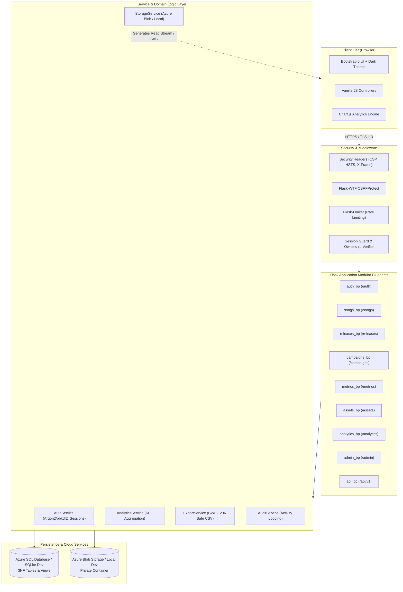

# IndieTrack — System Architecture

**Project:** IndieTrack — Music Release & Promotion Analytics Platform  
**Institution:** Chandigarh University, Lucknow  
**Student:** Prabudh Saxena Spring (UID: 25LBCS3112)  
**Programme:** B.Tech — Computer Science and Engineering (AI & ML)  

---

## 1. Architectural Philosophy & Overview

IndieTrack is designed as a **Modular Monolith** full-stack web application. It deliberately avoids premature microservice distributed complexity, instead prioritizing:
- Clean modular boundaries via **Flask Blueprints**
- Strong relational integrity with **Third Normal Form (3NF)**
- Dual-mode data persistence (Azure SQL Database in production with encrypted TDS/ODBC; SQLite development fallback)
- Scalable object storage (Azure Blob Storage with private containers; safe local filesystem fallback)
- Robust defense-in-depth application security (Argon2id/pbkdf2 password hashing, strict CSRF validation, server-side resource ownership checks, and formula injection sanitization)

```
+-----------------------------------------------------------------------------------+
|                                 CLIENT TIER                                       |
|  Responsive Browser (HTML5, Bootstrap 5, Dark Theme, ES6+ Vanilla JS, Chart.js)   |
+------------------------------------------+----------------------------------------+
                                           | HTTPS / TLS 1.3
                                           v
+-----------------------------------------------------------------------------------+
|                        APPLICATION TIER (Flask Web Server)                       |
|                                                                                   |
|  +---------------------+  +----------------------+  +--------------------------+  |
|  |   Security Layer    |  |    Core Blueprints   |  |     Service Layer        |  |
|  | - Security Headers  |  | - auth & profile     |  | - AuthService            |  |
|  | - CSRF Protection   |  | - songs & releases   |  | - StorageService (Azure) |  |
|  | - Rate Limiter      |  | - campaigns & metrics|  | - AnalyticsService       |  |
|  | - Session Guards    |  | - assets & uploads   |  | - ExportService (CSV)    |  |
|  | - Ownership Checks  |  | - analytics & admin  |  | - AuditService           |  |
|  +---------------------+  +----------------------+  +--------------------------+  |
+---------------------+-------------------------------------+-----------------------+
                      |                                     |
                      | TDS Encrypted (pyodbc)              | HTTPS (Azure SDK)
                      v                                     v
+-------------------------------------+   +-----------------------------------------+
|             DATA TIER               |   |              STORAGE TIER               |
|      Azure SQL Database             |   |           Azure Blob Storage            |
|  - Relational 3NF Tables            |   |  - Private Container: indietrack-assets |
|  - CampaignPerformanceView          |   |  - Audio Demos & Album Artwork          |
|  - sp_LaunchReleaseCampaign (Atomic)|   |  - Scoped SAS / Authorized Proxy        |
|  - Non-Clustered Covering Indexes   |   +-----------------------------------------+
+-------------------------------------+
```

---

## 2. Component Architecture (Mermaid Diagram)



---

## 3. Tier-by-Tier Specification

### 3.1 Presentation Tier (Frontend)
- **Framework-Free Simplicity:** Built with semantic HTML5 and Bootstrap 5 without heavy JavaScript Single Page Application (SPA) frameworks.
- **Dynamic Charting:** Interactive visualizations rendered with Chart.js 4.4, fetching structured JSON datasets from server endpoints.
- **Dark-First Modern Aesthetics:** Custom CSS (`main.css`) utilizing CSS variables for theme switching (`--bg-primary`, `--accent-violet`, `--accent-blue`), persistent across sessions via browser `localStorage`.
- **Progressive Enhancement:** Server-rendered Jinja2 templates ensure instantaneous page loads, zero client hydration waterfalls, and resilient accessibility.

### 3.2 Application Tier (Backend)
- **Application Factory Pattern:** `indietrack.create_app()` initializes configurations, extensions, registers blueprints, and hooks error handlers.
- **Strict Role-Based Access Control (RBAC):** Decorators `@login_required` and `@admin_required` enforce endpoint accessibility.
- **Multi-Tenant Ownership Isolation:** Dedicated service verification functions (`verify_song_ownership`, `verify_campaign_ownership`, `verify_release_ownership`, `verify_asset_ownership`) inspect database foreign keys against the authenticated `current_user.artist_profile.artist_id`.
- **Validation Pipeline:** Dual-layer validation utilizing WTForms for HTML form submissions and Marshmallow schemas for JSON API payloads.

### 3.3 Relational Data Tier
- **Production Target:** Azure SQL Database (Serverless or General Purpose tier) running Microsoft SQL Server engine.
- **Driver:** Microsoft ODBC Driver 18 for SQL Server via `pyodbc` and SQLAlchemy dialect `mssql+pyodbc`.
- **Encrypted Communication:** Mandatory TLS encryption (`Encrypt=yes;TrustServerCertificate=no;`) preventing eavesdropping and man-in-the-middle attacks.
- **Views & Stored Procedures:**
  - `CampaignPerformanceView`: Aggregates impressions, clicks, spend, and calculates dynamic Cost-Per-Click (CPC) and Click-Through-Rate (CTR).
  - `sp_LaunchReleaseCampaign`: Implements atomic multi-table transaction creating release and campaign records within a unified `TRY...CATCH` block.

### 3.4 Object Storage Tier
- **Azure Blob Storage:** Stores binary music files (MP3, WAV, FLAC, M4A) and cover artwork (PNG, JPEG, WebP).
- **Private Container Enforcement:** Assets container `indietrack-assets` configured with private access level.
- **Streaming Proxy & SAS Capability:** Assets are streamed through authenticated server endpoints or accessed via short-lived time-bound Shared Access Signatures (SAS).
- **Local Fallback:** In development mode without cloud credentials, `StorageService` seamlessly uses local directory `uploads/` while clearly annotating storage backend status.

---

## 4. Key Architectural Decisions (ADRs)

| ID | Title | Status | Rationale |
|---|---|---|---|
| ADR-001 | Modular Monolith vs. Microservices | Accepted | Avoids network overhead, distributed transactions, and operational complexity for a university capstone project. |
| ADR-002 | Server-Side Jinja2 vs. Client SPA | Accepted | Enhances security with HttpOnly cookies, avoids CSRF token synchronization issues, and eliminates frontend build pipelines. |
| ADR-003 | Dual Storage Strategy | Accepted | Enables offline local development without blocking cloud deployment readiness for Azure Blob Storage. |
| ADR-004 | Formula Injection Defense | Accepted | Sanitizes all CSV export fields starting with `=`, `+`, `-`, `@`, `\t`, `\r` by prefixing a single quote `'` to mitigate spreadsheet command execution vulnerabilities (CWE-1236). |
