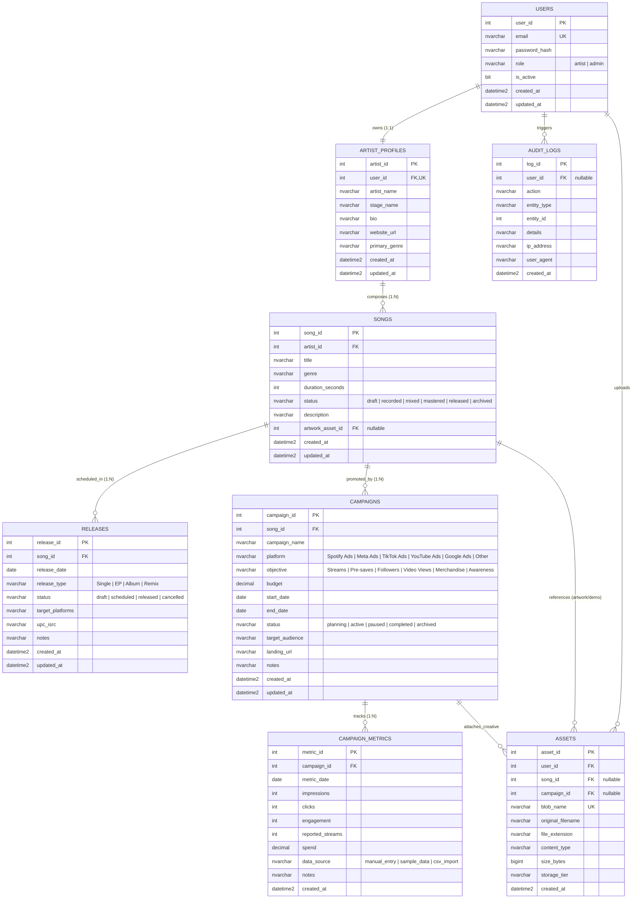

# IndieTrack — Relational Database Specification & ER Diagram

**Project:** IndieTrack — Music Release & Promotion Analytics Platform  
**Target RDBMS:** Azure SQL Database (Transact-SQL) / SQLite 3 (Dev Fallback)  
**Schema Normalization:** Third Normal Form (3NF)  

---

## 1. Entity-Relationship Diagram (Mermaid)

---

## 2. Normalization Analysis (Third Normal Form — 3NF)

The schema satisfies all relational normalization criteria:

### 2.1 First Normal Form (1NF)
- **Atomic Attributes:** Every column stores a single scalar value (e.g., individual counts, dates, prices). There are no comma-separated arrays or multi-valued attributes.
- **Unique Primary Keys:** Every entity defines a distinct primary key (`user_id`, `artist_id`, `song_id`, `release_id`, `campaign_id`, `metric_id`, `asset_id`, `log_id`).

### 2.2 Second Normal Form (2NF)
- **Full Functional Dependency:** The schema operates with single-column surrogate primary keys. Hence, no partial functional dependency on composite keys can exist.
- Non-key attributes are fully dependent on the entire primary key.

### 2.3 Third Normal Form (3NF)
- **Elimination of Transitive Dependencies:**
  - In a denormalized schema, `Songs` might duplicate `artist_name`, `artist_bio`, or `artist_website`. In IndieTrack, artist details exist strictly in `ArtistProfiles`. Songs reference only `artist_id`.
  - In `CampaignMetrics`, metric records depend strictly on `campaign_id` and `metric_date`. Campaign platform, budget, and song associations are resolved via foreign keys rather than being repeated on daily metric entries.
  - Derived calculations (such as Cost Per Click or Click-Through-Rate) are calculated dynamically at query/view time (`CampaignPerformanceView`) rather than stored redundantly in the table.

---

## 3. Database Objects & Transact-SQL Artifacts

### 3.1 Views
1. **`CampaignPerformanceView`**:
   - Aggregates daily metrics grouped by campaign, song, and platform.
   - Computes dynamic aggregated KPIs: `total_impressions`, `total_clicks`, `total_spend`, `total_streams`, `avg_cpc`, and `avg_ctr_percent`.
   - Protects against division-by-zero errors using `NULLIF(SUM(clicks), 0)`.
2. **`SongReleaseSummaryView`**:
   - Joins `Songs`, `ArtistProfiles`, and `Releases` to provide a consolidated catalog overview.

### 3.2 Stored Procedure (`sp_LaunchReleaseCampaign`)
- Demonstrates an **atomic multi-table business transaction**.
- Accepts parameters for a new release and an accompanying promotional campaign.
- Executes within a `BEGIN TRANSACTION` block.
- Implements `TRY...CATCH` logic: upon error (e.g. invalid date order or constraint violation), it invokes `ROLLBACK TRANSACTION` and returns the error message, ensuring zero partial data commits.

### 3.3 Trigger (`trg_UpdateSongTimestamp`)
- Automatically updates `updated_at = SYSDATETIME()` on the `Songs` table whenever a row is modified via `AFTER UPDATE`.

### 3.4 Non-Clustered Indexes
Carefully selected to optimize query performance without incurring excessive write penalties:
- `IX_users_email` (Unique lookup)
- `IX_songs_artist_id` & `IX_songs_status` (Catalog filtering)
- `IX_releases_song_id` & `IX_releases_date` (Release radar lookups)
- `IX_campaigns_song_id` & `IX_campaigns_platform` (Platform performance queries)
- `IX_campaign_metrics_campaign_date` (Date-range filtering)
- `IX_assets_user_id` (Asset library listing)
- `IX_audit_logs_user_id` & `IX_audit_logs_timestamp` (Compliance auditing)
